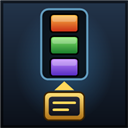

# Forever Flyout Macros

Custom flyouts for World of Warcraft: Forever. Each flyout is a macro you put on an action bar: click it, and a popup bar of spells, items, toys, mounts and macros flies out, like Blizzard's mage portal flyout. Works in combat.

<br clear="left">

- One action-bar slot opens a popup of up to 24 buttons, anchored to that slot.
- Opens up, down, left or right, in one or more columns/rows.
- Shows cooldowns, item counts, and tints buttons when you lack power or can't use them, like the default bars.
- Works with Blizzard bars, Bartender4 and ElvUI.
- Edit bars in a window that opens attached to the macro window (`/macro`). The popup stays open while you edit, so you see changes on the bar.

## Install

1. Download the latest version from [GitHub](https://github.com/saestad/Forever-Flyout-Macros): **Code > Download ZIP**, or a release if there is one.
2. Unzip it into `World of Warcraft\_forever_\Interface\AddOns\`.
3. **Rename the folder to `ForeverMacroDropdown`.** GitHub ZIPs unpack as `Forever-Flyout-Macros-main`, and WoW only loads the addon when the folder name matches `ForeverMacroDropdown.toc`. (The folder keeps the addon's original name, Forever Macro Dropdown, so existing settings carry over.)
4. Restart the game or type `/reload`.

Or clone it straight into the AddOns folder. Give the folder name at the end, as below: without it, git names the folder after the repo and WoW won't load the addon.

```
cd "World of Warcraft\_forever_\Interface\AddOns"
git clone https://github.com/saestad/Forever-Flyout-Macros.git ForeverMacroDropdown
```

The `.toc` targets WoW: Forever patch 1.60.1 (`## Interface: 16001`). After a game patch, if the addon shows as out of date or incompatible, run `/dump select(4, GetBuildInfo())` in game and put that number in the `## Interface:` line.

## Opening the addon

The bar editor always opens together with Blizzard's macro window, attached to its right side:

- `/ffm` opens the bar editor and the macro window, or closes them. `/ffm options` (or `/ffm option`, `/ffm config`) only opens them.
- **Minimap button**: left-click does the same as `/ffm`, right-click opens the settings page, drag to move it. If another addon has loaded LibDBIcon, the button is registered through it, so minimap button collectors and square minimaps work.
- **AddOns compartment** (the menu by the minimap): same clicks as the minimap button.
- **`/macro`**: opening the macro window yourself also opens the editor next to it. The addon icon in the macro window's title bar shows or hides the editor.

How the two windows go together:
- Closing either one closes both, when they were opened together. If you opened `/macro` yourself, closing the editor leaves the macro window open.
- If the editor was already open on its own before the macro window opened, it attaches while the macro window is open, then goes back to its own position.
- Selecting one of the addon's macros in the macro window selects that bar in the editor.
- In combat the macro window can't be used, so the editor opens on its own.
- To always use the editor on its own, turn off "Open the bar editor together with the macro window" in the settings page.

**Settings page** (Options > AddOns > Forever Flyout Macros, or `/ffm settings`; not in combat): an overview of your bars, a button that opens the editor, the minimap button, login message and macro window settings, the slash commands, and a copyable link to this GitHub page.

## Use

1. Type a name in **New bar** (max 16 characters, which is also the macro name) and click **Create**. This also creates the macro.
2. Drag spells, items, toys, mounts or macros into the grid. You can also type a name or ID, or shift-click a link into the box under the grid. Enter adds the first match (spell, then item, then macro). The **Spell**, **Item** and **Macro** buttons say which kind you mean. Use them when a name is both a spell and an item, such as Hearthstone.
3. Choose where the popup opens: **Up**, **Down**, **Left** or **Right**.
4. Drag the macro icon (top left of the editor), the bar in the list, or click **Pick Up Macro**, and drop it on an action bar.
5. Click that action button to open the popup, and click it again to close.

Grid:
- Drag an entry to another slot to reorder.
- Shift-click an entry to make it first. The first entry (gold frame) sets the macro's icon and cooldown.
- Right-click removes an entry.

The bar list shows each bar's icon, entry count and status: green check = on an action bar, yellow = macro exists but isn't on a visible bar, red = macro not created on this character yet. Hover a bar for details.

Messages about what you just did (added, removed, errors) show in the editor under the grid. When the editor is closed they go to chat.

Options per bar:
- **Columns / Rows**: how many columns a vertical popup has (or rows, for a horizontal one). Entries fill the line nearest the action button first, then the popup grows in its direction. For example, opening up with 3 columns puts entries 1-3 in the bottom row, 4-6 above them, and so on. 1 = a single line.
- **Spacing**: gap between the popup's buttons.
- **Close after use**: hides the popup after you click one of its buttons.
- **Background**: dark backdrop and border behind the popup.
- **Auto-hide**: closes the popup after the mouse has been away from it for N seconds (0 = off).
- **Character only**: puts the macro in the character's macros instead of the General (account-wide) ones. Switching moves an existing macro and keeps it on the same action bar slots. Bars are saved account-wide. Each character that uses a character-only bar gets its own macro the first time you place it on that character.

Managing bars:
- **Rename** renames the bar and its macro. The macro stays on the same action bar slots.
- **Duplicate** copies a bar's contents and settings under a new name ("Name 2").
- **Delete** removes the bar and its macro (after a confirmation).
- **Show Popup** / **Hide Popup** opens or closes the popup next to the macro's action button.

### Adjusting a popup on the action bar

While the editor is open, popups stay open: clicks elsewhere in the UI (the editor, spellbook, bags) don't close them and auto-hide is paused. Open the popup from its action button (or with **Show Popup**), then add, remove and reorder entries or change direction, columns/rows, spacing and background, and the popup updates in place. Clicking the macro again, Escape, and clicking the game world still close it. When the editor closes, auto-hide resumes.

Popup buttons show cooldowns, item counts, and are tinted like the default action bars: blue when you lack mana/power, grey when unusable.

Closing the popup:
- Click the macro again.
- Press Escape.
- Click outside the popup. Clicking the game world closes it, and that click is used up, so it doesn't target or turn the camera. Out of combat, clicking any other UI element also closes it, except while the editor is open (see above). In combat, clicks on other UI elements are left alone.

## Slash commands

`/fmd` (the command from before the rename) and `/macrodropdown` work everywhere `/ffm` does.

| Command | What it does |
| --- | --- |
| `/ffm` | Open or close the bar editor (with the macro window) |
| `/ffm options` | Open the bar editor (with the macro window). `/ffm option` and `/ffm config` do the same |
| `/ffm settings` | Open the settings page in Options > AddOns |
| `/ffm new <name>` | Create a bar (and its macro) |
| `/ffm list` | List your bars with entry count, direction, layout and whether the macro is on an action bar |
| `/ffm scan` | Re-find which action buttons hold your macros (if a popup opens in the wrong place) |
| `/ffm minimap` | Show or hide the minimap button |
| `/ffm help` | List these commands in chat |

On login a single chat line shows the version and the two main commands. Turn it off in Options > AddOns.

## Limits

- Up to 24 entries per bar.
- Bar names are macro names: at most 16 characters, unique, and not the name of a macro you made yourself.
- Each bar uses one macro slot. Blizzard allows 120 general (account-wide) and 18 character-specific macros. If they're full, the addon says so and you need to delete a macro first.
- Items can be added by name only if the game has seen them this session. Otherwise drag the item in, shift-click its link, or use its item ID.
- Bars can't be created or changed in combat. Popups still open, close and cast in combat.

## Troubleshooting

- **The addon isn't in the AddOns list, or is marked out of date.** Check the folder is named exactly `ForeverMacroDropdown`. After a game patch, update the `## Interface:` number (see Install).
- **The popup opens in the middle of the screen.** The macro isn't on a visible action button, or the addon hasn't noticed yet. Put the macro on a bar and run `/ffm scan`.
- **The bar list shows a red icon.** That character doesn't have the macro yet (for example a character-only bar on a new character). Drag the macro icon onto an action bar to create it.
- **"A macro named X exists but wasn't made by this addon."** You have your own macro with that name. Rename the bar or your macro.
- **I edited the macro text and my changes disappeared.** The addon manages the macro text and rewrites it. Put custom macros in the popup as macro entries instead.
- **Show Popup, or right-clicking the minimap button, does nothing.** Check you're not in combat: the editor's buttons are disabled then, and the settings page can't open.
- **The macro window didn't open with the editor.** You're in combat, or "Open the bar editor together with the macro window" is turned off in `/ffm settings`.

## Saved settings

Bars and settings are saved account-wide in `WTF\Account\<account>\SavedVariables\ForeverMacroDropdown.lua`. To start over, log out and delete that file. This doesn't delete the macros; remove them in `/macro` (each one's text is `/click FMDToggle<number>`).

## How it works

- Each bar has a hidden secure button `FMDToggle<id>`. The macro is `/click FMDToggle<id>`, which runs a secure snippet to show or hide the popup. The popup's buttons are `SecureActionButtonTemplate` buttons.
- The popup anchors to the action button that holds the macro, and its buttons match that button's size and scale. It supports Blizzard bars and LibActionButton bars (Bartender4, ElvUI). If the macro isn't on a visible bar, the popup opens near screen centre.
- Bars can't be edited during combat (a Blizzard restriction). The editor shows "In combat - editing paused" and greys out. Changes made by events during combat are applied when combat ends.
- The addon manages the macro text. Manual edits to the macro body are overwritten. The macro is `#showtooltip <first entry>` (for spells and items, which gives the icon and cooldown) followed by the `/click` line.
- While the editor is open, each popup has an `fmd-editing` attribute set. The secure toggle then skips registering auto-hide, and auto-hide on an already open popup is cancelled with `SecureHandlerExecute`. It is re-armed when the editor closes.
- Opening the editor loads `Blizzard_MacroUI` if needed and shows `MacroFrame` with `ShowUIPanel`. The editor attaches by hooking `MacroFrame`'s `OnShow`/`OnHide`. It doesn't change the macro window itself, apart from adding a small button to its title bar.

## Files

| File | Purpose |
| --- | --- |
| `Core.lua` | Saved data, bar/entry management, macro creation, events, slash commands |
| `Popup.lua` | Secure toggle and popup frames, anchoring to action buttons |
| `Config.lua` | The bar editor window, docking to the macro window |
| `Launcher.lua` | Minimap button, AddOns compartment entry, Options > AddOns page |
| `Media/Icon.tga` | Addon icon used in game (128×128, 32-bit TGA) |
| `Media/Icon.png` | Same icon for GitHub |

## Bugs and ideas

Report bugs or suggest features in [GitHub issues](https://github.com/saestad/Forever-Flyout-Macros/issues). Please include:

- the addon version (shown in the editor's title bar and in Options > AddOns)
- what you did, what you expected, and what happened
- any Lua error text (turn on errors with `/console scriptErrors 1`, or use BugSack)

## Changelog

See [CHANGELOG.md](CHANGELOG.md).

## Author

Made by [saestad](https://github.com/saestad).
